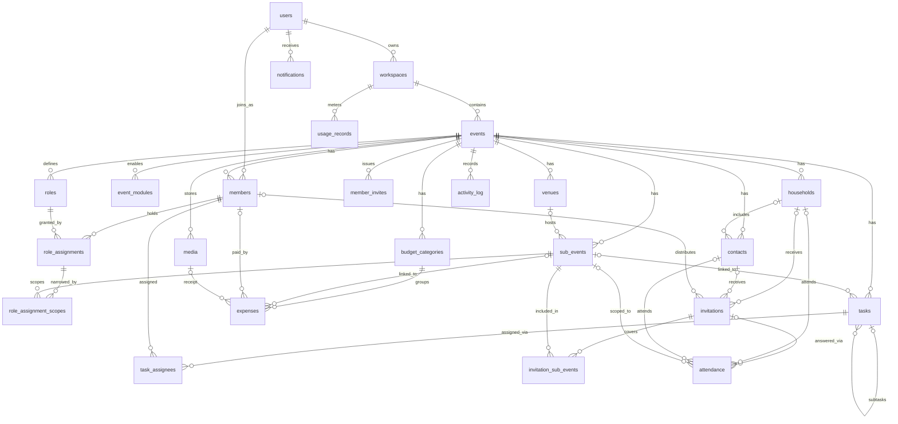

# Plan My Event — Database Design

Oct 15, 2026 · @Parv Jain

One PostgreSQL database holds all MVP data in 23 domain tables, 3 auth tables and 4 infrastructure tables; every event-owned row carries event\_id, and the database itself enforces tenancy, money, uniqueness and cross-event safety wherever it can, not only the application.

This doc expands Step 3b of the system design (Plan My Event — System Design) into a build-ready schema. It refines two choices from that doc: role scopes and invitation sub-events move from uuid arrays to join tables, so foreign keys clean them up when a sub-event is deleted.

## Overview and conventions

| Concern | Convention |
| --- | --- |
| Engine | PostgreSQL 17 or newer (NULLS NOT DISTINCT needs 15+); one database, one public schema |
| Extensions | citext (case-insensitive email), pg\_trgm (fuzzy name search) |
| ORM and migrations | Drizzle schema in packages/db; SQL migrations generated and reviewed, committed to git |
| Naming | snake\_case, plural table names, singular column names; foreign keys named \<table>\_id |
| Primary keys | id uuid, UUIDv7 generated in the app (time-ordered, index-friendly); Postgres 18's uuidv7() can be the default later |
| Tenant key | event\_id on every event-owned row; workspace\_id only on events, workspaces and usage\_records |
| Timestamps | timestamptz, stored in UTC; created\_at and updated\_at default now() on every domain table |
| Calendar dates | date type for date-only values (event start and end, task due date) |
| Authorship | created\_by\_user\_id on user-created rows, nullable for system and guest writes |
| Optimistic locking | version integer not null default 1, incremented by every update; writes include where version = $expected |
| Soft delete | deleted\_at timestamptz on user-facing rows; partial indexes add where deleted\_at is null; undo restores by clearing it |
| Money | bigint paise, check (value >= 0); INR only, no currency column |
| Value sets | text columns with a check constraint, generated from shared TypeScript constants (easier to extend than Postgres enum types) |
| Flexible data | jsonb only for settings, form answers, payloads and activity snapshots; never for columns used in filters or joins |
| Secrets | Tokens stored as SHA-256 hashes in bytea; raw tokens exist only in links |
| Deletes | Foreign keys default to on delete restrict; join tables cascade; hard deletes happen only through retention jobs or event deletion |

**Notation in the table sections:** PK primary key, FK foreign key, UQ unique, NN not null. Every domain table also has id, created\_at, updated\_at; the tables list only what is specific to them, plus version and deleted\_at where those apply.

## Entity-relationship diagram

Everything hangs off events, and events off workspaces; attendance is the hub where guests, invitations and sub-events meet.



Not shown: the three Better Auth tables (linked to users) and the outbox, idempotency\_keys and webhook\_inbox tables, which deliberately have no foreign keys.

## Enumerations

Every closed value set below is a text column with a check constraint; the same lists live as TypeScript constants in packages/contracts, so web, API and database agree.

| Value set | Used in | Values |
| --- | --- | --- |
| plan | workspaces.plan | free, pro |
| event\_type | events.type | wedding, conference, fair, celebration, custom |
| event\_status | events.status | draft, planning, live, completed, archived |
| guest\_scope | events.guest\_scope | whole\_event, per\_sub\_event |
| response\_mode | events.response\_mode, sub\_events.response\_mode | invite\_only, invite\_rsvp, open\_registration (ticketed added later) |
| visibility | sub\_events.visibility | public, private, invite\_only |
| module | event\_modules.module | guests, registration, gallery (V2: agenda, website, checkin, vendors; Later: exhibitors, sponsors, tickets) |
| member\_status | members.status | active, removed |
| task\_status | tasks.status | todo, in\_progress, blocked, done |
| task\_priority | tasks.priority | low, medium, high, urgent |
| payment\_status | expenses.payment\_status | planned, advance\_paid, partially\_paid, paid |
| delivery\_status | invitations.delivery\_status | not\_sent, sent\_digitally, delivered\_in\_person |
| attendance\_source | attendance.source | invited, registered (ticket added later) |
| attendance\_status | attendance.status | invited, confirmed, declined, registered, waitlisted, cancelled, checked\_in |
| media\_kind | media.kind | gallery, receipt, cover |
| media\_status | media.status | pending, ready, failed |
| channel | activity\_log.channel | app, public\_link, system, ai, whatsapp |
| webhook\_status | webhook\_inbox.status | received, processing, processed, failed |
| usage\_metric | usage\_records.metric | ai\_call, email\_sent, whatsapp\_message, storage\_bytes |

Adding a value is a one-line migration that replaces the check constraint. Removing one needs a data migration first.

## Identity and tenancy

Users are global; everything else hangs off a workspace, and every user gets a personal workspace in the same transaction as sign-up.

### users

| Column | Type | Constraints | Notes |
| --- | --- | --- | --- |
| email | citext | NN, UQ | Login identity for Google and email OTP |
| email\_verified | boolean | NN, default false | Set by Better Auth |
| name | text | NN | Display name |
| phone | text |  | E.164 format; used for WhatsApp linking in V2 |
| avatar\_url | text |  |  |
| locale | text | NN, default 'en' | For future translations |
| deleted\_at | timestamptz |  | Account deletion; personal data scrubbed by a job |

### Auth tables (sessions, accounts, verifications)

Owned by Better Auth and generated from its Drizzle adapter: sessions (token, user\_id, expires\_at, ip, user\_agent), accounts (provider links such as Google, user\_id), verifications (email OTP codes with expiry). We do not edit these by hand; we only add indexes the library recommends, plus index(user\_id) on sessions and accounts.

### workspaces

| Column | Type | Constraints | Notes |
| --- | --- | --- | --- |
| name | text | NN | "Parv's workspace" by default |
| owner\_user\_id | uuid | NN, FK users |  |
| is\_personal | boolean | NN, default true | Hidden personal workspace in MVP |
| plan | text | NN, default 'free', check plan | Read by plan-limit checks |
| version | integer | NN, default 1 |  |

Indexes: index(owner\_user\_id); unique(owner\_user\_id) where is\_personal, so each user has exactly one personal workspace.

Team workspaces (Later) add a workspace\_members table; nothing in this schema has to change for them.

## Events and program

The event row is the tenant root: it carries the guest scope, the default response mode and two counters (roles\_version, content\_version) that make caches safe to invalidate.

### events

| Column | Type | Constraints | Notes |
| --- | --- | --- | --- |
| workspace\_id | uuid | NN, FK workspaces | Tenant scoping |
| owner\_user\_id | uuid | NN, FK users | Mirrors the Owner role assignment; changed only by ownership transfer |
| type | text | NN, check event\_type | Template used at creation |
| name | text | NN |  |
| slug | text | NN, UQ | Public URL /e/\<slug>; lowercase, 3-60 chars, check regex |
| description | text |  |  |
| cover\_media\_id | uuid | FK media | Nullable; FK added after media exists |
| starts\_on, ends\_on | date | NN, check ends\_on >= starts\_on |  |
| time\_zone | text | NN, default 'Asia/Kolkata' | IANA name; all timestamps stored in UTC |
| status | text | NN, default 'draft', check event\_status |  |
| guest\_scope | text | NN, default 'whole\_event', check guest\_scope |  |
| response\_mode | text | NN, default 'invite\_only', check response\_mode | Used when guest\_scope = whole\_event |
| roles\_version | integer | NN, default 1 | Bumped on any role or assignment change; part of the permission cache key |
| content\_version | integer | NN, default 1 | Bumped when public-facing details change; part of the invitation cache key |
| budget\_paise | bigint | check >= 0 | Overall budget; null until the owner sets one |
| settings | jsonb | NN, default '{}' | Template labels and UI preferences only |
| version, deleted\_at |  |  | Standard |

Indexes: unique(slug); index(workspace\_id, status) where deleted\_at is null.

### event\_modules

| Column | Type | Constraints | Notes |
| --- | --- | --- | --- |
| event\_id | uuid | NN, FK events, PK part |  |
| module | text | NN, PK part, check module |  |
| enabled | boolean | NN |  |
| config | jsonb | NN, default '{}' | Module-specific options |

Primary key (event\_id, module); no separate id. The template writes one row per module at event creation.

### venues

| Column | Type | Constraints | Notes |
| --- | --- | --- | --- |
| event\_id | uuid | NN, FK events |  |
| name | text | NN | "Hotel Radisson lawn" |
| address | text |  |  |
| map\_url | text |  | Google Maps link |
| deleted\_at | timestamptz |  |  |

Indexes: index(event\_id); unique(event\_id, id) so child tables can use composite foreign keys.

### sub\_events

| Column | Type | Constraints | Notes |
| --- | --- | --- | --- |
| event\_id | uuid | NN, FK events |  |
| name | text | NN | "Mehendi", "Keynote" |
| starts\_at, ends\_at | timestamptz | NN, check ends\_at > starts\_at |  |
| venue\_id | uuid | FK (event\_id, venue\_id) to venues(event\_id, id) | Composite FK: the venue must belong to the same event |
| capacity | integer | check capacity > 0 | Null = unlimited |
| visibility | text | NN, default 'invite\_only', check visibility |  |
| response\_mode | text | check response\_mode | Used only when guest\_scope = per\_sub\_event; null otherwise |
| group\_label | text |  | Track, zone or category label for grouping |
| notes | text |  |  |
| position | integer | NN, default 0 | Manual ordering within a day |
| version, deleted\_at |  |  | Standard |

Indexes: index(event\_id, starts\_at) where deleted\_at is null; unique(event\_id, id) for composite foreign keys.

## Team and permissions

A member holds roles through role\_assignments; an assignment with no scope rows applies to the whole event, and each scope row narrows it to one sub-event. Composite foreign keys guarantee a member, a role and a scoped sub-event all belong to the same event.

### members

| Column | Type | Constraints | Notes |
| --- | --- | --- | --- |
| event\_id | uuid | NN, FK events |  |
| user\_id | uuid | NN, FK users |  |
| status | text | NN, default 'active', check member\_status | Removed members keep their history |
| phone | text |  | Verified WhatsApp number for the V2 bot |
| invited\_by\_user\_id | uuid | FK users |  |
| joined\_at | timestamptz | NN, default now() |  |
| removed\_at | timestamptz |  |  |
| version | integer | NN, default 1 |  |

Indexes: unique(event\_id, user\_id); unique(event\_id, id); index(user\_id) for "my events".

### roles

| Column | Type | Constraints | Notes |
| --- | --- | --- | --- |
| event\_id | uuid | NN, FK events |  |
| name | text | NN | "Admin", "Catering Coordinator" |
| description | text |  |  |
| is\_standard | boolean | NN, default false | Created from the template; still editable except Owner |
| is\_owner | boolean | NN, default false | The single Owner role; immutable |
| permissions | text\[\] | NN, default '{}' | Values from the permission catalog in code |
| version, deleted\_at |  |  | Standard |

Indexes: unique(event\_id, lower(name)) where deleted\_at is null; unique(event\_id) where is\_owner, so each event has exactly one Owner role; unique(event\_id, id).

### role\_assignments

| Column | Type | Constraints | Notes |
| --- | --- | --- | --- |
| event\_id | uuid | NN | Present so both composite FKs can be enforced |
| member\_id | uuid | NN, FK (event\_id, member\_id) to members | Cascade on member delete |
| role\_id | uuid | NN, FK (event\_id, role\_id) to roles | Restrict: a role in use cannot be hard-deleted |
| granted\_by\_user\_id | uuid | FK users |  |

Indexes: unique(member\_id, role\_id); index(event\_id, member\_id); index(role\_id).

### role\_assignment\_scopes

| Column | Type | Constraints | Notes |
| --- | --- | --- | --- |
| role\_assignment\_id | uuid | NN, FK role\_assignments, cascade |  |
| event\_id | uuid | NN |  |
| sub\_event\_id | uuid | NN, FK (event\_id, sub\_event\_id) to sub\_events, cascade | Deleting a sub-event removes its scope rows |

Primary key (role\_assignment\_id, sub\_event\_id); index(sub\_event\_id). No rows means the assignment covers the whole event.

One edge case needs application handling: if every scoped sub-event of an assignment is deleted, the assignment would silently widen to the whole event. The deleteSubEvent action therefore removes assignments that would be left with no scope rows, in the same transaction.

### member\_invites

| Column | Type | Constraints | Notes |
| --- | --- | --- | --- |
| event\_id | uuid | NN, FK events |  |
| token\_hash | bytea | NN, UQ | SHA-256 of the link token |
| email | citext |  | Set for email invites; null for shareable links |
| grants | jsonb | NN | List of { roleId, subEventIds } applied on accept; re-validated then |
| expires\_at | timestamptz | NN | Default 7 days |
| max\_uses | integer | NN, default 1, check > 0 | Shareable links may allow more |
| used\_count | integer | NN, default 0, check used\_count <= max\_uses | Incremented under row lock |
| revoked\_at | timestamptz |  |  |
| created\_by\_user\_id | uuid | NN, FK users |  |

Indexes: unique(token\_hash); index(event\_id).

### Permission catalog

Permissions are code, not data: a constant list in packages/contracts (event.view, tasks.edit, budget.view and the rest from the PRD). roles.permissions stores those strings. The app rejects unknown values on write; if a permission is renamed or removed, a migration rewrites the arrays. Standard role presets are also constants, copied into each event's roles at creation, so later edits to presets never change existing events.

## Planning

Tasks and expenses can optionally point at a sub-event; composite foreign keys keep every reference inside the same event, and check constraints keep payment amounts consistent with their status.

### tasks

| Column | Type | Constraints | Notes |
| --- | --- | --- | --- |
| event\_id | uuid | NN, FK events |  |
| sub\_event\_id | uuid | FK (event\_id, sub\_event\_id) to sub\_events | Null = whole event |
| parent\_task\_id | uuid | FK (event\_id, parent\_task\_id) to tasks | Subtasks; one level only, enforced in the action |
| title | text | NN, check length 1-200 |  |
| description | text |  |  |
| status | text | NN, default 'todo', check task\_status |  |
| priority | text | NN, default 'medium', check task\_priority |  |
| category | text |  | Free label, e.g. Catering, Decor |
| due\_on | date |  |  |
| position | text | NN | Fractional index for drag-and-drop order within a status column |
| completed\_at | timestamptz |  | check: set if and only if status = 'done' |
| completed\_by\_user\_id | uuid | FK users |  |
| template\_key | text |  | Which starter task created it, for analytics |
| version, deleted\_at |  |  | Standard |

Indexes: unique(event\_id, id); index(event\_id, status, due\_on) where deleted\_at is null; index(event\_id, sub\_event\_id) where deleted\_at is null; index(parent\_task\_id) where parent\_task\_id is not null.

### task\_assignees

| Column | Type | Constraints | Notes |
| --- | --- | --- | --- |
| task\_id | uuid | NN, FK (event\_id, task\_id) to tasks, cascade |  |
| event\_id | uuid | NN |  |
| member\_id | uuid | NN, FK (event\_id, member\_id) to members, cascade |  |

Primary key (task\_id, member\_id); index(member\_id) serves "My tasks".

### budget\_categories

| Column | Type | Constraints | Notes |
| --- | --- | --- | --- |
| event\_id | uuid | NN, FK events |  |
| name | text | NN | Catering, Venue, Decor |
| planned\_paise | bigint | NN, default 0, check >= 0 |  |
| position | integer | NN, default 0 |  |
| version, deleted\_at |  |  | Standard |

Indexes: unique(event\_id, lower(name)) where deleted\_at is null; unique(event\_id, id).

### expenses

| Column | Type | Constraints | Notes |
| --- | --- | --- | --- |
| event\_id | uuid | NN, FK events |  |
| category\_id | uuid | NN, FK (event\_id, category\_id) to budget\_categories |  |
| sub\_event\_id | uuid | FK (event\_id, sub\_event\_id) to sub\_events |  |
| title | text | NN | "Caterer advance" |
| vendor\_name | text |  | Replaced by vendor\_id in V2; kept for history |
| amount\_paise | bigint | NN, check > 0 | Total owed for this line |
| paid\_paise | bigint | NN, default 0, check 0 <= paid\_paise <= amount\_paise | Paid so far |
| payment\_status | text | NN, default 'planned', check payment\_status |  |
| due\_on | date |  | Next payment due |
| paid\_on | date |  | Last payment date |
| paid\_by\_member\_id | uuid | FK (event\_id, paid\_by\_member\_id) to members | Who paid; supports cost splitting later |
| receipt\_media\_id | uuid | FK (event\_id, receipt\_media\_id) to media |  |
| transaction\_ref | text |  | UPI UTR or bank reference |
| notes | text |  |  |
| version, deleted\_at |  |  | Standard |

Status consistency check: planned means paid\_paise = 0; paid means paid\_paise = amount\_paise; advance\_paid and partially\_paid mean 0 < paid\_paise < amount\_paise.

Indexes: index(event\_id, category\_id) where deleted\_at is null; index(event\_id, payment\_status, due\_on) where deleted\_at is null, for pending payments; unique(event\_id, transaction\_ref) where transaction\_ref is not null and deleted\_at is null, which blocks duplicate payment screenshots.

## Guests and attendance

Attendance is the single table every headcount is computed from: one row per household or contact, either for the whole event (sub\_event\_id null) or per sub-event, whatever the response mode. Invitations carry the magic link and the physical delivery status.

### households

| Column | Type | Constraints | Notes |
| --- | --- | --- | --- |
| event\_id | uuid | NN, FK events |  |
| name | text | NN | "Sharma family" |
| expected\_count | smallint | NN, default 1, check 1-50 | Organizer's estimate; drives invite-only headcount |
| primary\_contact\_id | uuid | FK (event\_id, primary\_contact\_id) to contacts | Whose phone gets the invitation |
| version, deleted\_at |  |  | Standard |

Indexes: unique(event\_id, id); index(event\_id) where deleted\_at is null.

### contacts

| Column | Type | Constraints | Notes |
| --- | --- | --- | --- |
| event\_id | uuid | NN, FK events |  |
| household\_id | uuid | FK (event\_id, household\_id) to households | Optional |
| name | text | NN |  |
| phone | text |  | E.164; normalized on write |
| email | citext |  |  |
| tags | text\[\] | NN, default '{}' | VIP, bride side, speaker |
| notes | text |  |  |
| version, deleted\_at |  |  | Standard |

Indexes: unique(event\_id, id); index(event\_id, household\_id); GIN(tags); GIN(name gin\_trgm\_ops) for search; index(event\_id, phone) and index(event\_id, email) for duplicate detection (not unique: families share numbers).

### invitations

| Column | Type | Constraints | Notes |
| --- | --- | --- | --- |
| event\_id | uuid | NN, FK events |  |
| household\_id | uuid | FK (event\_id, household\_id) to households |  |
| contact\_id | uuid | FK (event\_id, contact\_id) to contacts |  |
| token\_hash | bytea | NN, UQ | SHA-256 of the magic-link token |
| delivery\_status | text | NN, default 'not\_sent', check delivery\_status |  |
| distributor\_member\_id | uuid | FK (event\_id, distributor\_member\_id) to members | Who hands over the card |
| sent\_at, delivered\_at | timestamptz |  |  |
| last\_opened\_at | timestamptz |  | Updated at most once per hour per link |
| revoked\_at | timestamptz |  | Revoked links stop working; a new token can be issued |
| version, deleted\_at |  |  | Standard |

Checks: num\_nonnulls(household\_id, contact\_id) = 1. Indexes: unique(token\_hash); unique(event\_id, household\_id) and unique(event\_id, contact\_id) where deleted\_at is null, so a guest has one live invitation; index(event\_id, delivery\_status); index(distributor\_member\_id).

### invitation\_sub\_events

Used only when guest\_scope = per\_sub\_event; lists which sub-events an invitation covers.

| Column | Type | Constraints | Notes |
| --- | --- | --- | --- |
| invitation\_id | uuid | NN, FK invitations, cascade |  |
| event\_id | uuid | NN |  |
| sub\_event\_id | uuid | NN, FK (event\_id, sub\_event\_id) to sub\_events, cascade |  |

Primary key (invitation\_id, sub\_event\_id); index(sub\_event\_id).

### attendance

| Column | Type | Constraints | Notes |
| --- | --- | --- | --- |
| event\_id | uuid | NN, FK events |  |
| sub\_event\_id | uuid | FK (event\_id, sub\_event\_id) to sub\_events | Null = whole event |
| household\_id | uuid | FK (event\_id, household\_id) to households |  |
| contact\_id | uuid | FK (event\_id, contact\_id) to contacts |  |
| invitation\_id | uuid | FK (event\_id, invitation\_id) to invitations | Null for open registrations |
| source | text | NN, check attendance\_source | invited or registered |
| status | text | NN, check attendance\_status |  |
| party\_size | smallint | NN, default 1, check 1-50 | Starts at expected\_count; replaced by the RSVP answer |
| answers | jsonb | NN, default '{}' | Standard fields now, form-builder answers in V2 |
| responded\_at | timestamptz |  |  |
| qr\_token\_hash | bytea | UQ | V2 check-in |
| checked\_in\_at | timestamptz |  |  |
| checked\_in\_by\_member\_id | uuid | FK (event\_id, checked\_in\_by\_member\_id) to members |  |
| version | integer | NN, default 1 |  |

Checks: num\_nonnulls(household\_id, contact\_id) = 1; source = 'invited' requires invitation\_id.

Indexes: unique(event\_id, sub\_event\_id, household\_id, contact\_id) nulls not distinct, so one row per guest per scope and RSVP or registration resubmits update the same row; index(event\_id, sub\_event\_id, status) for headcounts; unique(qr\_token\_hash) where not null.

Attendance has no deleted\_at: removing a guest from a sub-event sets status to cancelled, so headcount history and undo stay intact.

## Platform

Media rows describe files that live in R2; the activity log is append-only and shaped for monthly partitioning from day one; notifications are per user, across events.

### media

| Column | Type | Constraints | Notes |
| --- | --- | --- | --- |
| event\_id | uuid | NN, FK events |  |
| kind | text | NN, check media\_kind | gallery, receipt, cover |
| status | text | NN, default 'pending', check media\_status | Worker sets ready or failed |
| bucket | text | NN, check in ('public', 'private') | Receipts always private |
| storage\_key | text | NN, UQ | events/\<eventId>/\<kind>/\<id>.\<ext> |
| mime | text | NN | Verified by the worker, not trusted from the client |
| bytes | bigint | NN, check > 0 | Counted into storage usage |
| width, height | integer |  | Set after processing |
| variants | jsonb | NN, default '{}' | Keys of thumbnail and display versions |
| sub\_event\_id | uuid | FK (event\_id, sub\_event\_id) to sub\_events | Album grouping |
| caption | text |  |  |
| uploaded\_by\_user\_id | uuid | FK users |  |
| deleted\_at | timestamptz |  | File removed from R2 by a job 30 days later |

Indexes: unique(event\_id, id); unique(storage\_key); index(event\_id, kind, created\_at desc) where status = 'ready' and deleted\_at is null.

### activity\_log

| Column | Type | Constraints | Notes |
| --- | --- | --- | --- |
| id | uuid | NN | UUIDv7 |
| created\_at | timestamptz | NN, default now() | Partition key later |
| event\_id | uuid | NN, FK events |  |
| actor\_user\_id | uuid | FK users | Null for guests and system |
| actor\_label | text | NN | "Rahul", "Sharma family (link)", "System" |
| channel | text | NN, check channel | app, public\_link, system, ai, whatsapp |
| action | text | NN | Dotted name, e.g. task.completed, expense.created |
| entity\_type | text | NN | task, expense, attendance |
| entity\_id | uuid | NN |  |
| before, after | jsonb |  | Changed fields only, not whole rows |
| request\_id | text |  | Ties entries from one request or one AI proposal together |
| undo\_of\_id | uuid |  | Set on the entry that records an undo |
| undone\_at | timestamptz |  | Set on the entry that was undone |

Primary key (created\_at, id): including the timestamp lets the table become range-partitioned by month without changing the key. No updated\_at or version; rows are never edited except undone\_at.

Indexes: index(event\_id, created\_at desc); index(entity\_type, entity\_id, created\_at desc) for an entity's history and undo checks.

### notifications

| Column | Type | Constraints | Notes |
| --- | --- | --- | --- |
| user\_id | uuid | NN, FK users, cascade |  |
| event\_id | uuid | FK events, cascade |  |
| type | text | NN | task\_assigned, task\_due, role\_changed, job\_failed |
| payload | jsonb | NN | Ids and short text for rendering |
| read\_at | timestamptz |  |  |

Indexes: index(user\_id, created\_at desc); index(user\_id) where read\_at is null for the unread badge. Read notifications older than 90 days are deleted by a scheduled job.

## Infrastructure tables

These four tables carry no user-facing data; they exist so that writes, retries and webhooks are safe. None of them has a foreign key to events, so deleting an event never blocks on in-flight side effects.

### outbox

| Column | Type | Constraints | Notes |
| --- | --- | --- | --- |
| id | bigint | PK, generated always as identity | Monotonic order for the relay |
| event\_id | uuid |  | For logging and per-event fairness; no FK |
| topic | text | NN | entity.changed, email.send, media.process, ... |
| dedupe\_key | text | NN | Becomes the BullMQ job id, e.g. invite-email:\<invitationId>:\<templateVersion> |
| payload | jsonb | NN |  |
| available\_at | timestamptz | NN, default now() | Later values delay publishing |
| attempts | integer | NN, default 0 |  |
| last\_error | text |  |  |
| published\_at | timestamptz |  | Null until relayed |
| created\_at | timestamptz | NN, default now() |  |

Indexes: index(available\_at, id) where published\_at is null, the relay's only query. Published rows are deleted after 7 days.

### idempotency\_keys

| Column | Type | Constraints | Notes |
| --- | --- | --- | --- |
| scope | text | NN, PK part | user:\<userId> for members, invite:\<tokenHash> or ip:\<hash> for public calls |
| key | text | NN, PK part | Client-sent Idempotency-Key |
| request\_hash | bytea | NN | Same key with a different body returns 422 |
| status | text | NN, check in ('in\_progress', 'completed') | A concurrent retry while in\_progress gets 409 |
| response\_status | smallint |  |  |
| response\_body | jsonb |  | Replayed verbatim on retry |
| expires\_at | timestamptz | NN | created\_at + 24 hours |
| created\_at | timestamptz | NN, default now() |  |

Primary key (scope, key); index(expires\_at) for the cleanup job.

### webhook\_inbox

| Column | Type | Constraints | Notes |
| --- | --- | --- | --- |
| id | uuid | PK |  |
| provider | text | NN | whatsapp, email, later payments |
| external\_id | text | NN | Provider's message or event id |
| payload | jsonb | NN | Raw body as received |
| status | text | NN, default 'received', check webhook\_status |  |
| attempts | integer | NN, default 0 |  |
| last\_error | text |  |  |
| received\_at | timestamptz | NN, default now() |  |
| processed\_at | timestamptz |  |  |

Indexes: unique(provider, external\_id), so a redelivered webhook is ignored; index(status, received\_at) where status in ('received', 'failed'). Only signature-verified requests are inserted. Processed rows are deleted after 30 days.

### usage\_records

| Column | Type | Constraints | Notes |
| --- | --- | --- | --- |
| workspace\_id | uuid | NN, FK workspaces, PK part |  |
| metric | text | NN, PK part, check usage\_metric |  |
| period | date | NN, PK part | First day of the month |
| amount | bigint | NN, default 0 |  |
| updated\_at | timestamptz | NN, default now() |  |

Counters (ai\_call, email\_sent, whatsapp\_message) are incremented inside the action's transaction with insert ... on conflict (workspace\_id, metric, period) do update set amount = usage\_records.amount + excluded.amount. storage\_bytes is a gauge recomputed nightly from media.

## Key queries and their indexes

Every hot path is a single indexed query scoped by event\_id; none needs more than a few milliseconds on a 5,000-guest event.

| Query | Served by | Cached? |
| --- | --- | --- |
| Effective permissions for a user in an event | members unique(event\_id, user\_id), role\_assignments index(event\_id, member\_id) | Yes, perm key with roles\_version |
| Headcount per sub-event | attendance index(event\_id, sub\_event\_id, status) | Yes, dashboard key |
| Budget vs. actual by category | expenses index(event\_id, category\_id) | Yes, dashboard key |
| My tasks across events | task\_assignees index(member\_id) + members index(user\_id) | No |
| Task board for an event | tasks index(event\_id, status, due\_on) | No |
| Invitation by magic link | invitations unique(token\_hash) | Yes, inv key with content\_version |
| Delivery progress | invitations index(event\_id, delivery\_status) | Yes, dashboard key |
| Guest search by name | contacts GIN trigram on name | No |
| Activity feed and entity history | activity\_log index(event\_id, created\_at desc), index(entity\_type, entity\_id, created\_at desc) | No |
| Outbox relay batch | outbox partial index(available\_at, id) | No |

**Effective permissions.** Rows with a null sub\_event\_id are whole-event grants; the guard unions them per scope.

```sql
select ras.sub_event_id, r.permissions
from members m
join role_assignments ra on ra.member_id = m.id
join roles r on r.id = ra.role_id and r.deleted_at is null
left join role_assignment_scopes ras on ras.role_assignment_id = ra.id
where m.event_id = $1 and m.user_id = $2 and m.status = 'active';
```

**Headcounts.** Declined and cancelled rows are excluded. For invite-only, invited rows count as expected because party\_size starts at the household's expected\_count.

```sql
select sub_event_id,
       sum(party_size) filter (where status in ('invited','confirmed','registered','checked_in')) as expected,
       sum(party_size) filter (where status in ('confirmed','registered','checked_in'))           as confirmed,
       sum(party_size) filter (where status = 'checked_in')                                       as checked_in
from attendance
where event_id = $1
group by sub_event_id;   -- one null row when guest_scope = whole_event
```

**Budget vs. actual.** Committed is the sum of expense amounts, paid is what has gone out, outstanding is the difference.

```sql
select c.id, c.name, c.planned_paise,
       coalesce(sum(e.amount_paise), 0) as committed_paise,
       coalesce(sum(e.paid_paise), 0)   as paid_paise
from budget_categories c
left join expenses e on e.category_id = c.id and e.deleted_at is null
where c.event_id = $1 and c.deleted_at is null
group by c.id
order by c.position;
```

**Outbox relay.** Rows are claimed, published and marked in one short transaction; a crash after publishing but before commit republishes the row, which consumers tolerate.

```sql
select id, topic, dedupe_key, payload
from outbox
where published_at is null and available_at <= now()
order by id
limit 100
for update skip locked;
-- publish each row, then:
update outbox set published_at = now() where id = any($1);
```

## Integrity, transactions and locking

The database enforces every rule it can express; the core action layer enforces the rest inside the same transaction, and a nightly check reports anything that slips through.

### Cross-event safety with composite foreign keys

Every event-owned parent table has unique(event\_id, id), and every child references it as (event\_id, parent\_id). A task can therefore never point at another event's sub-event, an expense at another event's category, or an assignment at another event's role, even if application code has a bug. The cost is one extra column in join tables and one extra unique index per parent.

### Who enforces what

| Rule | Enforced by |
| --- | --- |
| References stay inside one event | Database: composite foreign keys |
| One live invitation and one attendance row per guest per scope | Database: unique indexes |
| Exactly one of household or contact on invitations and attendance | Database: num\_nonnulls check |
| Payment amounts match payment status | Database: check constraint |
| No duplicate transaction reference per event | Database: partial unique index |
| One Owner role per event, one personal workspace per user | Database: partial unique indexes |
| Owner role is immutable; owner\_user\_id holds the Owner role | Core action, plus nightly check |
| Nobody grants permissions beyond their own | Core action |
| Subtasks are one level deep | Core action |
| Permission strings are valid | Core action, against the catalog |
| Response mode set on sub-events only when guest\_scope = per\_sub\_event | Core action |

### Transaction template for a core action

1. begin; set local lock\_timeout = '2s'; set local statement\_timeout = '5s'.
2. Update with the version guard: update tasks set ..., version = version + 1 where id = $id and event\_id = $eventId and version = $expected. Zero rows updated means someone else changed it: roll back and return 409 with the current row.
3. Insert the activity\_log row with before and after values.
4. Insert outbox rows and bump usage\_records if metered.
5. commit. Postgres's default read committed isolation is enough because every contended write is guarded by a version check, a row lock or a unique constraint.

### Places that take an explicit row lock

| Operation | Lock | Why |
| --- | --- | --- |
| Open registration with capacity | select ... for update on the sub\_events row | Two people cannot take the last seat |
| Accepting a member invite | select ... for update on member\_invites | used\_count cannot exceed max\_uses |
| Changing roles or assignments | update on events (roles\_version + 1) | Serializes role edits per event and invalidates permission caches |
| Switching guest scope | select ... for update on events | Blocks RSVPs and invitation edits during the conversion |

RSVPs and registrations need no lock: they are upserts on attendance's unique key, so a double submit updates the same row.

### Switching guest scope

Runs as a job (it can touch thousands of rows) in one transaction per event, holding the event row lock:

- **Whole event to per sub-event:** for each attendance row with a null sub\_event\_id, insert one copy per non-deleted sub-event with the same status and party\_size, then delete the original; add invitation\_sub\_events rows for every sub-event; set sub\_events.response\_mode from events.response\_mode.
- **Per sub-event back to whole event:** collapse each guest's rows into one null-scope row, keeping the largest party\_size and the most committed status (checked\_in, then confirmed or registered, then invited, then declined); delete invitation\_sub\_events rows.
- Bump events.version and content\_version, write one activity\_log entry, and emit one entity.changed for the event so every open screen re-fetches.

### Nightly consistency check

A scheduled job runs read-only queries and reports any rows found to Sentry: events whose owner\_user\_id has no active Owner assignment, role\_assignments left with no scope rows after scoped sub-events were deleted, attendance rows whose sub\_event\_id disagrees with the event's guest\_scope, and outbox rows unpublished for more than 5 minutes.

## Migrations, seeding, retention and backups

Schema changes ship as reviewed, backward-compatible SQL migrations; data is kept until its owner deletes it, with scheduled jobs cleaning up everything operational.

### Migrations

- Drizzle generates SQL from the schema in packages/db; every migration file is reviewed and committed, never applied with a push-to-database shortcut outside local development.
- Migrations run once per deploy, before new containers start, from a dedicated migrate step that takes a Postgres advisory lock so two deploys cannot run them together.
- **Expand, then contract.** Add new columns as nullable or with defaults, deploy code that writes both shapes, backfill in batches, then remove the old column in a later release. Old containers keep working during a rolling deploy.
- Indexes on large tables are created with create index concurrently in their own migration.
- Circular references (events.cover\_media\_id to media, households.primary\_contact\_id to contacts) are added as foreign keys in a second step after both tables exist.
- CI runs every migration against a fresh database and against a copy of the seed data.

### Seed data

| Seed | Contents | Used for |
| --- | --- | --- |
| Sharma Wedding | 5 sub-events, invite-only plus one RSVP dinner, 120 households, 3 card distributors, 40 tasks, 12 budget categories, 25 expenses | Demo and UI testing of the closed-event path |
| DevFest Bhopal | 1 day, 12 sessions in 3 tracks, open registration with capacity, 400 registrations | Demo of the open-event path and capacity logic |
| Load seed (script) | One 5,000-guest event with 15,000 activity rows | Checking query plans and dashboard latency before launch |

Seeds are idempotent scripts in packages/db that use fixed UUIDs, so they can be rerun safely.

### Retention

| Data | Kept for | Cleaned by |
| --- | --- | --- |
| Event and all its rows | Until the owner deletes the event | Delete-event job removes rows and R2 files in batches |
| Guest phone and email | Optional: 6 months after the event ends | Owner setting; job blanks the fields, keeps names and counts |
| Soft-deleted rows | 30 days, then hard-deleted | Scheduled job |
| Outbox rows | 7 days after publishing | Scheduled job |
| Idempotency keys | 24 hours | Scheduled job |
| Webhook inbox | 30 days after processing | Scheduled job |
| Read notifications | 90 days | Scheduled job |
| Activity log | Life of the event; partitions older than 12 months archived to R2 once partitioned | Monthly job |

### Partitioning

No table is partitioned at launch. activity\_log is the first candidate: its primary key already starts with created\_at, so it can be converted to monthly range partitions when it passes about 50 million rows, with no change to application queries.

### Backups and restore

- Managed Postgres daily backups with point-in-time recovery where the provider offers it.
- A weekly pg\_dump to a private R2 bucket, kept for 8 weeks, as an independent copy.
- A restore drill once a quarter into a scratch database, timed and noted in the ops log.

## Future tables

None of these are built in the MVP, but each slots in without changing an existing table's shape beyond adding a nullable column.

### V2

| Table | Purpose | Key columns | Change to existing tables |
| --- | --- | --- | --- |
| vendors | Vendor directory per event | event\_id, name, service, phone, email, notes | expenses.vendor\_id added (nullable) |
| form\_fields | Custom RSVP and registration questions | event\_id, sub\_event\_id, label, kind, options jsonb, required, position | None: answers already go in attendance.answers |
| task\_comments | Discussion on tasks | event\_id, task\_id, author\_user\_id, body | None |
| ai\_proposals | Pending AI quick-update proposals awaiting confirmation | event\_id, member\_id, channel, input\_text, input\_media\_id, actions jsonb, status, expires\_at | None |
| whatsapp\_links | Verified phone to user mapping for the bot | user\_id, phone, verified\_at | None |
| agenda\_speakers | Speakers linked to sessions | event\_id, contact\_id, sub\_event\_id, bio | None |

### Payments (Later)

As listed in the system design's "Designed for later: payments" section: subscriptions, ticket\_types, orders, order\_items, payments, refunds, invoices and payouts. They reuse the conventions here: bigint paise, unique gateway ids, webhook\_inbox for confirmations, and composite foreign keys to events and sub\_events. The only existing-table changes are adding ticket to the attendance\_source values, and attendance.order\_item\_id (nullable).

## Open questions

- [ ] Managed Postgres provider and version: confirm it offers PostgreSQL 17+ with citext and pg\_trgm, and point-in-time recovery on the free or entry plan.
- [ ] Guest data auto-delete: default on or off for new events.
- [ ] Event slug: globally unique as designed, or unique per workspace with a short prefix in the URL.
- [ ] Soft-delete window: 30 days for all user-facing rows, or longer for expenses.
